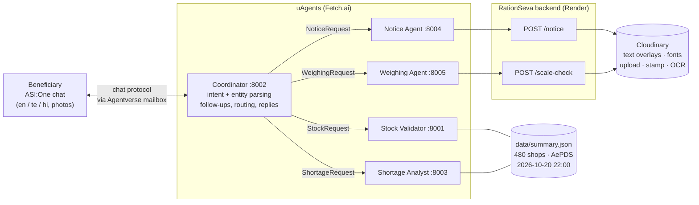

# RationSeva — multi-agent ration-shop assistant on ASI:One

RationSeva helps ration-card holders in Andhra Pradesh. In one ASI:One chat, in English, Telugu or Hindi, a beneficiary can:

- **check stock** at their fair-price shop (FPS),
- **find nearby shops** that still have a commodity when their own shop is low,
- **get a shareable stock-notice poster** in Telugu, Hindi or English, rendered by Cloudinary,
- **check whether their ration was weighed short** by sending a photo of the scale. Cloudinary OCR reads the display, and the user gets a complaint draft to review and send themselves.

Everything comes from real data: the **AP AePDS "Date wise Stock Details" public report** for **480 fair-price shops** in Alluri Sitharama Raju district (snapshot of **2026-10-20 22:00**), and the live **RationSeva backend** (FastAPI + Cloudinary) at <https://ration-seva.onrender.com> ([API docs](https://ration-seva.onrender.com/docs)).

## The problem

Beneficiaries often travel to their ration shop only to find a commodity has run out, and they have no easy way to know which nearby shop still has it. At the counter, under-weighing is hard to prove. The data to answer both questions is public, but it sits in government Excel reports that people can't use from a phone, and it is in English. RationSeva turns that report into a conversation in the beneficiary's own language. It adds two things a text answer can't give: a poster you can forward on WhatsApp, and time-stamped photo evidence of the weighing.

## Architecture



| Agent | File | Input → output | What it does |
|---|---|---|---|
| **Coordinator** (public, the only ASI:One agent) | [coordinator.py](coordinator.py) | `ChatMessage` → `ChatMessage` | Reads free text in English, Telugu and Hindi ([nlu.py](nlu.py)). Extracts the 7-digit FPS id, commodity, notice language, kg values and photo attachments. Asks a follow-up when something is missing, routes with `send_and_receive` (30 s timeout, one retry), and replies in the user's language ([replies.py](replies.py)). |
| **Stock Validator** | [main.py](main.py) | `StockRequest` → `StockResponse` | Looks up the shop (and optional commodity) in `data/summary.json`. Returns real quantities, status, `data_time`, source and flags. An unknown FPS gets `found=False`; nothing is invented. |
| **Shortage Analyst** (internal) | [shortage_analyst.py](shortage_analyst.py) | `ShortageRequest` → `ShortageAnalysis` | Marks an item LOW when closing stock is under 10% of the month's available stock (closing + issued), and OUT when closing is ≤ 0.01. **"Where else can I go?"** suggests up to 3 other shops in the same AFSO that have the commodity AVAILABLE, largest stock first. |
| **Notice Agent** (internal) | [notice_agent.py](notice_agent.py) | `NoticeRequest` → `NoticeResponse` | Calls `POST /notice`. Cloudinary renders a 1080×1080 stock poster with Telugu, Devanagari or Latin font overlays, using `f_auto`/`q_auto`. Returns the image URL, which is shown inline in chat. |
| **Weighing Agent** (internal) | [weighing_agent.py](weighing_agent.py) | `WeighingRequest` → `WeighingResponse` | Sends the photo to `POST /scale-check`. Cloudinary stores a time-stamped proof image and OCR reads the scale. The verdict is `OK`, `SHORT_WEIGHT`, `NEEDS_REVIEW` or `UNREADABLE`. On `SHORT_WEIGHT` the agent writes a **complaint draft** that the user must confirm; it is never filed automatically. Without a photo, it compares the weight the user typed. |

Message schemas: [messages.py](messages.py). Shared data access: [ration_data.py](ration_data.py). Shared env and backend helpers: [common.py](common.py).

### How the agents use Cloudinary

| Feature | Backend endpoint | Cloudinary work | Where it shows up in chat |
|---|---|---|---|
| Stock notice poster | `POST /notice` | Text overlays with uploaded Noto Sans Telugu / Devanagari fonts, `g_auto` crop, `f_auto,q_auto`, signed delivery URL | "Make a Telugu stock notice for 0306122" → inline poster + download link |
| Weighing check | `POST /scale-check` | Upload, `adv_ocr` text extraction of the scale display, stamped overlay (FPS id, event, IST time) | Photo + "entitled 20 kg" → verdict, stamped proof image, complaint draft that includes the proof URL |

The backend also has `POST /proof` (stamp + privacy blur). It isn't wired to an agent yet; see [Limitations](#limitations).

## Agent addresses

These addresses are derived from the seeds in `.env` (`python scripts/setup_env.py` prints them). Seeds are secret and never committed. Run the agents from a different `.env` and the addresses change.

| Agent | Address |
|---|---|
| Coordinator | `agent1q0gvf0grxdvpqzg4t4s55p5du4y97daurpd99sq40xc8en4qmkrvga9a2fv` |
| Stock Validator | `agent1q0ug5kw2v7spm6s6fsyfdrtyvl46zfefxnetx3m0ew6cmqxut5qmuk60m8l` |
| Shortage Analyst | `agent1qwgz0th408vvcq2fyh507lje9gk6f6tdhjrh6ns8u36xmgfepdgev9yqfth` |
| Notice Agent | `agent1qgmcr9ch2vlpkpl8rj5rmaaez58pgtl5u5urxn96r8xnykd83sue2wkhj2u` |
| Weighing Agent | `agent1q2jhnea464u46ewhc0d42qf9dquzhyau0uxevha3c8h9dstfsfu6s2qnel7` |

> The Shortage Analyst previously registered on Agentverse (`agent1qdj3kmjycxdfj6lp23yzmzg567a78ftn2gk9q5eyqqx8nwm8qy8qkfth24c`) used a seed that isn't in this repo. To keep that address, put that seed in `SHORTAGE_ANALYST_SEED` and rerun `scripts/setup_env.py`.

## Run it

Requires Python 3.11 or 3.12 (uagents does not support 3.14 yet).

```bash
python -m venv .venv
.venv\Scripts\activate            # Windows  (source .venv/bin/activate on macOS/Linux)
pip install -r requirements.txt
python scripts/setup_env.py       # creates .env, generates missing seeds, fills in agent addresses
```

**Local test (no Agentverse needed):**

```bash
python scripts/run_local.py --no-mailbox     # terminal 1: all five agents, logs in logs/
python scripts/test_chat.py                  # terminal 2: chats with the Coordinator like ASI:One does
python scripts/test_chat.py notice_te weighing --photo path/to/scale.jpg   # selected scenarios
```

`test_chat.py` sends real chat-protocol messages, including photos as `ResourceContent`. It prints the conversation and writes it to `logs/test_chat_results.md`. A recorded run, including the agent-down cases, is in [docs/TEST_RESULTS.md](docs/TEST_RESULTS.md).

**For ASI:One:** run `python scripts/run_local.py` (Coordinator with a mailbox), then connect the mailbox once. The steps are in [agentverse/COORDINATOR_README.md](agentverse/COORDINATOR_README.md#connect-the-mailbox-one-time).

### Environment

See [.env.example](.env.example): `BACKEND_URL`, the five seeds, the four internal agent addresses, `*_MAILBOX` switches (only the Coordinator needs a mailbox), `AGENT_TIMEOUT=30`, `BACKEND_TIMEOUT=25`.

## Try these in ASI:One

- "Is rice available at shop 0306122?"
- "Rice is low at my shop, where else can I go?" (the agent asks for the shop number)
- "Make a Telugu stock notice for 0306122"
- "Check my ration weight" + attach a photo of the scale (the agent asks for the shop number and entitled kg)
- "0306122 షాప్‌లో బియ్యం ఉందా?" · "मेरी दुकान 0306122 में चावल कम है, और कहाँ मिलेगा?"

## Reliability

- Every agent call uses `send_and_receive` with a 30 s timeout and **one retry**.
- Render's free tier sleeps and can take ~50 s to wake. The Notice and Weighing agents ping `/health` on startup, and each backend call times out at 25 s with `retryable=True`, so the Coordinator's retry lands on a warm backend.
- If an agent is down, the user gets a clear localized message. When it makes sense, they also get the real stock as text: the notice falls back to the stock list, and a missing analysis falls back to the report status. Verified in [docs/TEST_RESULTS.md](docs/TEST_RESULTS.md).

## Limitations

- **Dated snapshot, not live.** All stock is from the AePDS report of 2026-10-20 22:00, and every reply says so. Stock may have changed since then.
- **Coverage:** 480 shops in one district (Alluri Sitharama Raju). Any other FPS id gets "not found".
- **Alternatives** are grouped by AFSO (the data has no mandal or GPS). They are suggestions from the same snapshot, not distances.
- **Language understanding is rule-based** (keywords + regex). That keeps it predictable, but unusual phrasing gets the help message or a follow-up question.
- **Complaints are drafts only.** RationSeva never files anything; the user sends it (PDS helpline 1967, Mandal office or grievance portal).
- **ASI:One photo attachments** arrive through Agentverse storage. The Coordinator downloads them with its own agent identity and forwards the bytes. Locally this path was tested with URL and `data:` URI attachments; check it once in ASI:One after connecting the mailbox.
- The internal agents use `127.0.0.1` endpoints, so they must run on the same machine as the Coordinator (or set their `*_MAILBOX=true`).
- `POST /proof` (doorstep-delivery / complaint photos with privacy blur) is not wired to an agent yet.
- `stock_tools.py` is a standalone opening/received/issued/closing balance checker kept from the first prototype. The agents don't use it, because the published report has no opening balance.

## Repository layout

```
coordinator.py         ASI:One chat agent (routing, follow-ups, replies)
main.py                Stock Validator
shortage_analyst.py    Shortage Analyst + "where else can I go?"
notice_agent.py        Cloudinary stock notice (POST /notice)
weighing_agent.py      Cloudinary OCR weighing check (POST /scale-check)
messages.py            uAgents message models
nlu.py / replies.py    en/te/hi understanding and reply templates
ration_data.py         data/summary.json access, status rule, alternatives
common.py              env, agent factory, backend client
data/summary.json      480-shop AePDS snapshot (2026-10-20 22:00)
scripts/               setup_env.py, run_local.py, test_chat.py
agentverse/            Agentverse READMEs (Coordinator, Shortage Analyst)
docs/TEST_RESULTS.md   recorded local test run
NOTION_NOTES.md        decisions, challenges, learnings
```
